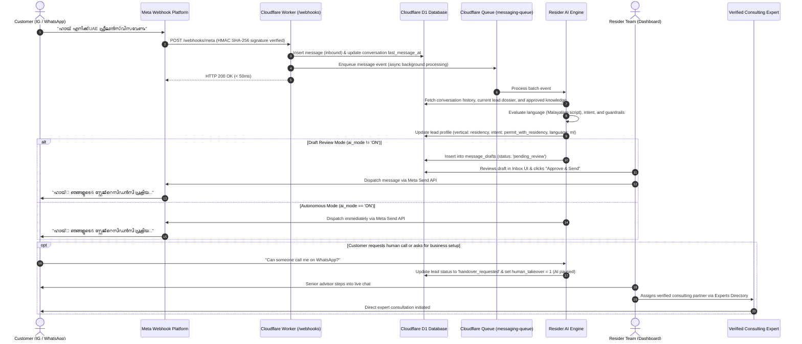

# RESIDER — UAE Residency & Business-Setup Concierge CRM

**RESIDER** is an AI-powered conversational concierge and CRM platform built specifically for UAE residency and business-setup consulting. It unifies customer communications across **Instagram Direct Messages** and **WhatsApp Business**, enforces strict commercial guardrails, stages AI responses for human review, and matches qualified leads with verified consulting partners.

---

## 1. End-to-End Lead Lifecycle Flow

The diagram and steps below describe what happens from the moment a customer sends their first message to final consultation handover:



### Detailed Flow Breakdown

#### Step 1: Inbound Webhook Reception
1. An inquiry arrives via **WhatsApp Business Cloud API** or **Instagram Graph API**.
2. Cloudflare Worker verifies the payload authenticity using the `X-Hub-Signature-256` HMAC SHA-256 signature against `META_APP_SECRET`.
3. Worker upserts the `conversations` record, writes the raw message into `messages`, and pushes the event onto Cloudflare Queue `nexo-messaging-queue`.
4. The HTTP response completes in **< 50ms**, ensuring zero webhook timeouts from Meta.

#### Step 2: Queue Consumer & Context Injection
1. The queue consumer pulls the batch and loads:
   - Conversation history (last 10 inbound & outbound messages).
   - Current customer dossier from `leads`.
   - **Approved Knowledge Base Items** (`is_approved_by_client = 1`).
   - Active **Verified Consulting Partners** (`verified_experts`).

#### Step 3: Resider AI Protocol Execution
The prompt generator executes the client-approved rules:
- **Language & Tone Matching:** Detects Malayalam script (`ഹായ്` $\rightarrow$ replies in Malayalam script), Manglish, or English. Mirrors casual terms like "bro" only if initiated by the customer.
- **Answer First, 1 Question Follow-up:** Answers the customer's specific question before asking a single relevant follow-up question. Never bombards with multiple questions.
- **Privacy Shield:** Never requests passport copies, nationality, or sensitive IDs in chat.
- **Section 9 Pricing Guardrail:** Unapproved package prices (Long-Term Permit AED 7k–7.5k, Freelance from AED 7.5k, Residency AED 15k–20k) are **strictly shielded** and never quoted unless toggled as approved in the Knowledge Base.
- **Auto-Pause on Handover:** If the customer asks to speak with someone, requests a call, or expresses urgency, the AI sets `lead_status = 'handover_requested'` and activates `human_takeover = 1` (AI auto-replies paused).

#### Step 4: Staged Draft Review Mode
- Unless a conversation is explicitly switched to autonomous mode (`ai_mode === 'ON'`), all generated AI replies are staged in the `message_drafts` table with `status = 'pending_review'`.
- Operators see an **AI Draft Review Bar** directly above the message composer in the Omnichannel Inbox:
  - **Approve & Send:** Dispatches live to the customer via Meta Send API.
  - **Edit in Composer:** Copies the text into the editor for operator modification before sending.
  - **Reject:** Dismisses the draft without sending.

#### Step 5: Verified Expert Referral (Business Setup)
- If an enquiry is for business setup (mainland/freezone license, corporate tax), the AI explains that Resider works with verified consulting partners and asks for explicit permission before sharing details.
- Once permitted, the operator can match and assign a partner in the **Verified Experts Directory** based on sector, language, and Emirate.

---

## 2. The 7 Canonical Resider Lead Statuses

Every conversation resolves to one of the 7 official pipeline states:

| Status | Code | Description & Trigger |
| :--- | :--- | :--- |
| **Needs Clarification** | `needs_clarification` | Initial or ambiguous message (e.g., "Hi", "tell me details"). AI asks 1 brief clarifying question. |
| **Exploring** | `exploring` | Customer understands the services, is learning about the 6 delivery stages, but has not decided on timeline or pathway. |
| **Ready for Team** | `ready_for_team` | Basic facts collected (vertical, timeline, location, activity). Customer is prepared for a structured consultation. |
| **Handover Requested** | `handover_requested` | Customer requested a call, WhatsApp chat, or direct human contact. AI automatically pauses. |
| **Handed Over** | `handed_over` | Team member or verified consulting partner has taken ownership of the lead. |
| **Support Enquiry** | `support_enquiry` | Existing client asking about status of an active application, medical test, or Emirates ID. |
| **Outside Scope / Spam** | `outside_scope_spam` | Non-UAE residency inquiries (e.g. Europe student visas, job seeking, unrelated spam). |

---

## 3. Tech Stack

- **Runtime:** Cloudflare Workers (Edge V8 isolate runtime, < 1.5ms active CPU execution)
- **Database:** Cloudflare D1 (Serverless SQLite with indexed schema)
- **Asynchronous Pipeline:** Cloudflare Queues (`max_batch_size: 1`, dead-letter queue enabled)
- **Frontend SPA:** React 18, Vite, TanStack Query v5, TailwindCSS, Lucide Icons
- **AI Inference:** Dynamic OpenAI-compatible providers (Groq, Cloudflare Workers AI, OpenAI) with AES-256-GCM encrypted credential vault
- **Channel Integrations:** Meta Graph API v21.0 (Instagram Messaging + WhatsApp Cloud API)

---

## 4. Deployment Guide via Wrangler

Deploy the complete application to Cloudflare Workers and D1 using the Cloudflare Wrangler CLI.

### Prerequisites
1. **Node.js** (v18+ or v20+)
2. **Cloudflare Account** and Wrangler CLI authenticated:
   ```bash
   npx wrangler login
   ```

---

### Step-by-Step Deployment

#### 1. Install Dependencies
```bash
npm install
```

#### 2. Configure Cloudflare D1 Database
If deploying for the first time, create your D1 database:
```bash
npx wrangler d1 create nexo-db
```
*Copy the generated `database_id` into your [`wrangler.jsonc`](file:///d:/NVPs/nexo/wrangler.jsonc) file.*

#### 3. Run Database Migrations
Apply all 6 migrations (schemas, triggers, indexes, and seed data) to the remote D1 instance:
```bash
npx wrangler d1 migrations apply nexo-db --remote
```
*(To run migrations locally for testing: `npx wrangler d1 migrations apply nexo-db --local`)*

#### 4. Configure Cloudflare Queues
Create the primary queue and dead-letter queue:
```bash
npx wrangler queues create nexo-messaging-queue
npx wrangler queues create nexo-messaging-dlq
```

#### 5. Set Environment Secrets
Store your encryption keys and Meta webhook tokens in Cloudflare Secrets Vault:
```bash
# 32-byte Base64 encryption key for token & API key storage
npx wrangler secret put META_TOKEN_ENCRYPTION_KEY

# Meta Webhook verification token (must match your Meta App Dashboard)
npx wrangler secret put META_WEBHOOK_VERIFY_TOKEN

# Meta App Secret for validating webhook signatures
npx wrangler secret put META_APP_SECRET
```

#### 6. Build the Frontend Single-Page App
Compile and bundle the production dashboard:
```bash
npm run build:frontend
```
This outputs production assets to `./frontend/dist`, which are automatically served as static assets by Cloudflare Workers.

#### 7. Deploy to Cloudflare Edge
Deploy both the backend worker and the static dashboard with a single command:
```bash
npx wrangler deploy
```

---

## 5. Development & Testing Commands

```bash
# Run unit & integration test suite (Vitest)
npm test

# Check TypeScript types (Frontend & Worker)
npm run typecheck --workspace=frontend
npx tsc --noEmit

# Start worker locally with local D1 & Queues
npm run dev

# Start frontend development server with Vite hot-reload
npm run dev:frontend
```

---

## 6. Security & Data Protection

- **No Passport / Sensitive ID Storage:** Chat channels explicitly instruct customers not to post passport copies or national IDs in chat.
- **AES-256-GCM Credential Vault:** LLM API keys and Meta OAuth tokens are encrypted using AES-256-GCM before writing to D1.
- **Cryptographic Webhook Signatures:** Inbound webhooks from Instagram and WhatsApp must pass SHA-256 signature verification (`X-Hub-Signature-256`).
- **Tenant Isolation:** All CRM tables enforce row-level scoping by `tenant_id` on all primary and composite indexes.
