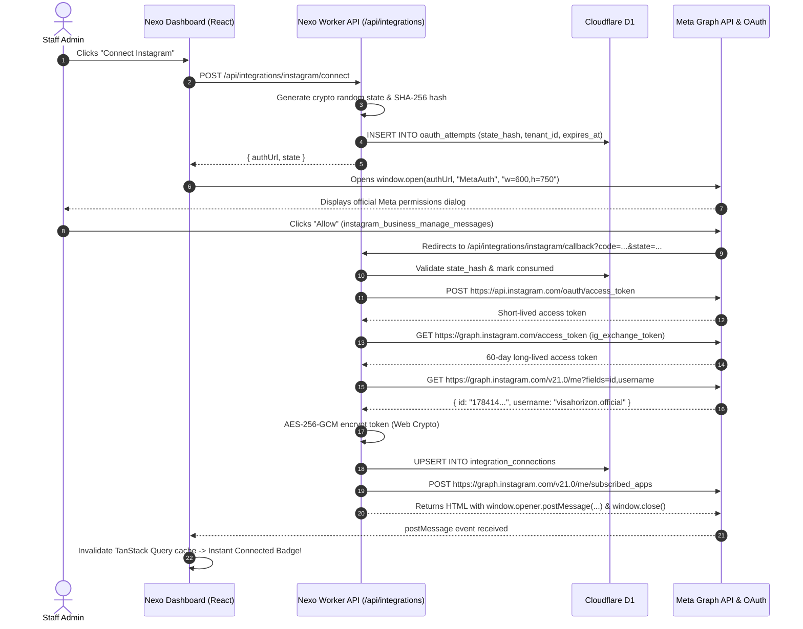

# Phase 3 Detailed Plan: 1-Click Meta Instagram Popup OAuth & Webhook Pipeline

This document establishes the exhaustive, file-by-file engineering specification for **Phase 3 (1-Click Meta Instagram OAuth Popup, Token Lifecycle, Durable Webhook Ingestion & Queue Consumer)**.

---

## 1. User Experience: Seamless 1-Click Popup Authorization Flow

The user experience is designed as an effortless, 1-click native flow:
1. Staff member clicks **"Connect Instagram"** in the Nexo Dashboard (`IntegrationsView.tsx`).
2. The frontend calls `POST /api/integrations/instagram/connect` to generate a cryptographically secure, single-use `state` token bound to the active tenant.
3. The frontend opens the official Meta/Instagram authorization dialog inside a focused popup window:
   ```javascript
   const popup = window.open(authUrl, 'MetaAuthPopup', 'width=600,height=750,scrollbars=yes');
   ```
4. The user logs in to their Instagram Professional account and clicks **"Allow"** to grant:
   - `instagram_business_basic`
   - `instagram_business_manage_messages`
5. Meta redirects to our backend callback URL (`/api/integrations/instagram/callback?code=...&state=...`) inside the popup.
6. The backend:
   - Verifies the single-use state hash against D1 `oauth_attempts`.
   - Exchanges the authorization code server-side for an access token.
   - Exchanges the short-lived token for an official **60-day long-lived access token**.
   - Fetches the Instagram Professional account metadata (`id`, `username`, `profile_picture_url`).
   - Encrypts the token with **Web Crypto AES-256-GCM** using a fresh random IV.
   - Persists the connection to D1 `integration_connections`.
   - Subscribes the app to the Instagram account's DM webhooks.
   - Returns a lightweight HTML bridge to the popup:
     ```html
     <script>
       window.opener.postMessage({ type: 'NEXO_META_CONNECTED', provider: 'instagram' }, window.location.origin);
       window.close();
     </script>
     ```
7. The Nexo Dashboard receives the `postMessage`, plays a success notification, invalidates the TanStack Query cache, and instantly displays the connected account badge (`@visahorizon.official`, "Connected", Webhooks Healthy) without a page reload!



---

## 2. Webhook Ingestion & Active CPU Budget (< 1.8 ms)

Inbound DMs from Meta must be processed with extreme speed and zero memory buffering:
1. `GET /webhooks/meta/instagram`:
   - Validates `hub.mode === 'subscribe'` and compares `hub.verify_token` against `WEBHOOK_VERIFY_TOKEN` using constant-time string comparison (`constantTimeEqual`).
   - Returns raw `hub.challenge` string with status 200. Active CPU: **< 0.4 ms**.
2. `POST /webhooks/meta/instagram`:
   - Checks `Content-Length` (< 128 KiB).
   - Reads raw text once: `const rawBody = await c.req.raw.text()`.
   - Validates `X-Hub-Signature-256` header in constant-time using Web Crypto HMAC-SHA256 (`verifyMetaSignature`). Active CPU: **~0.3 ms**.
   - Single-pass parse of top-level event fields: extracts `entry`, `messaging`, `message.mid`, sender ID, recipient ID, text.
   - Derives deterministic event key: `ig_msg_{connectionId}_{providerMessageId}`.
   - D1 atomic batch: Inserts into `webhook_events` with status `received`.
   - Enqueues lightweight pointer to Cloudflare Queue: `{ eventId: webhookEvent.id, schemaVersion: 1 }`.
   - Returns `200 OK` immediately. Total active CPU: **~1.7 ms** (83% safety margin under 10.0 ms hard ceiling).

---

## 3. Queue Consumer: Asynchronous AI Inference & Outbound Reply

The Cloudflare Queue consumer (`worker/queue/consumer.ts`) executes the asynchronous lead qualification:
1. **Picks up message pointer** `{ eventId }` (batch size = 1 on Free tier).
2. **Reloads authoritative event** from D1 `webhook_events`.
3. **Acquires durable conversation lease** in D1 (`lease_owner = workerId, lease_expires_at = now + 30s`).
4. **Retrieves conversation context**: Fetches up to 10 recent messages and current lead facts from D1.
5. **Pre-send Check 1**: Confirms conversation is not under human takeover (`human_takeover = 0`) and AI mode is not `OFF`.
6. **AI Inference**: Calls `openAiCompatibleAdapter.generateQualification()` using the tenant's decrypted default AI provider (e.g. Groq / OpenAI).
   - Extracts applicant details (destination country, education, timeline, visa category).
   - Generates score (0–100) and rationale.
   - Formulates concise, natural follow-up question.
7. **Pre-send Check 2**: Re-checks that no newer customer message arrived while the LLM was computing.
8. **Outbound Dispatch**: Sends reply to customer via Meta Instagram Send API (`POST https://graph.instagram.com/v21.0/me/messages`).
9. **D1 State Update**: Updates message status to `delivered`, updates `leads` record, records run telemetry in `ai_runs`.
10. **Acks queue message**.

---

## 4. Directory Layout & File Breakdown for Phase 3

```
nexo/
├── shared/
│   ├── types/
│   │   └── meta.types.ts              # Expanded with OAuth state, connect responses, and send payloads
│   └── schemas/
│       └── meta.schema.ts             # Zod validation for OAuth callback query and webhook payloads
├── worker/
│   ├── adapters/
│   │   └── meta/
│   │       ├── instagramOAuth.ts      # Token exchange, 60-day refresh, profile metadata fetching
│   │       ├── instagramSendApi.ts    # Meta Graph API outbound message dispatcher
│   │       └── instagramWebhook.ts    # Bounded webhook normalizer & deduplication key builder
│   ├── repositories/
│   │   ├── connectionRepository.ts    # D1 queries for integration_connections with AES-256-GCM
│   │   ├── conversationRepository.ts  # Conversation lease locking, thread queries, message logging
│   │   └── leadRepository.ts          # Upserting AI-extracted lead profiles and scoring components
│   ├── services/
│   │   └── instagramService.ts        # Coordinates OAuth handshake, webhook subscriptions, and token refresh
│   ├── routes/
│   │   ├── instagramOAuth.routes.ts   # /api/integrations/instagram/connect, /callback, /recheck, /disconnect
│   │   └── webhook.routes.ts          # GET/POST /webhooks/meta/instagram (HMAC, outbox write, queue enqueue)
│   ├── queue/
│   │   └── consumer.ts                # Real queue consumer pipeline (Lease -> Context -> AI -> Send -> D1)
│   └── index.ts                       # Mount webhook routes and wire up queue consumer
├── frontend/
│   └── src/
│       ├── hooks/
│       │   └── useIntegrations.ts     # TanStack Query hook with window.open popup & postMessage listener
│       └── views/
│           └── IntegrationsView.tsx   # 1-Click Connect Instagram button with live popup and account card
└── tests/
    ├── instagramOAuth.test.ts         # Unit tests for state hashing, token exchange, and postMessage HTML
    ├── instagramWebhook.test.ts       # Tests for HMAC signature validation, payload normalization, dedupe keys
    └── queueConsumer.test.ts          # Tests for lease acquisition, pre-send safety checks, and AI response saving
```

---

## 5. Granular Conventional Commits Sequence for Phase 3

1. **`feat(meta)`**: `feat(meta): implement Instagram Login OAuth flow, token exchange, and AES-256-GCM storage`
   - Files: `shared/types/meta.types.ts`, `worker/adapters/meta/instagramOAuth.ts`, `worker/repositories/connectionRepository.ts`
2. **`feat(api)`**: `feat(api): add 1-click popup OAuth endpoints and HTML bridge for Instagram`
   - Files: `worker/routes/instagramOAuth.routes.ts`, `worker/services/instagramService.ts`
3. **`feat(webhook)`**: `feat(webhook): implement signature-verified Instagram webhook receiver and queue enqueue`
   - Files: `worker/adapters/meta/instagramWebhook.ts`, `worker/routes/webhook.routes.ts`
4. **`feat(queue)`**: `feat(queue): implement asynchronous queue consumer with AI qualification and Instagram Send API`
   - Files: `worker/adapters/meta/instagramSendApi.ts`, `worker/queue/consumer.ts`, `worker/repositories/conversationRepository.ts`, `worker/repositories/leadRepository.ts`
5. **`feat(ui)`**: `feat(ui): add 1-click Instagram popup connection flow with postMessage listener in IntegrationsView`
   - Files: `frontend/src/hooks/useIntegrations.ts`, `frontend/src/views/IntegrationsView.tsx`
6. **`test(meta)`**: `test(meta): add unit and integration tests for Instagram OAuth, webhooks, and queue pipeline`
   - Files: `tests/instagramOAuth.test.ts`, `tests/instagramWebhook.test.ts`

---

## 6. Definition of Done for Phase 3

Phase 3 is complete when:
1. Clicking "Connect Instagram" launches a 600x750 centered popup window directing to Meta's authorization dialog.
2. Granting permission executes server-side code exchange, generates a 60-day long-lived token, encrypts it via Web Crypto AES-256-GCM, saves the connection to D1, and closes the popup automatically via `window.opener.postMessage`.
3. The dashboard UI receives the message and immediately displays the connected account details without a page refresh.
4. Meta webhooks (`/webhooks/meta/instagram`) verify HMAC signatures in constant-time and enqueue events to Cloudflare Queue in **< 1.8 ms active CPU**.
5. The queue consumer executes the AI qualification pipeline asynchronously, updates D1 lead fields, and dispatches the reply via Instagram Send API.
6. All automated unit tests pass with `npm run test` and TypeScript compiles cleanly with `npm run typecheck`.
