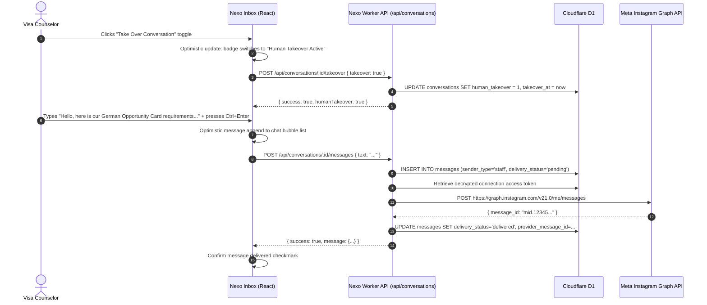
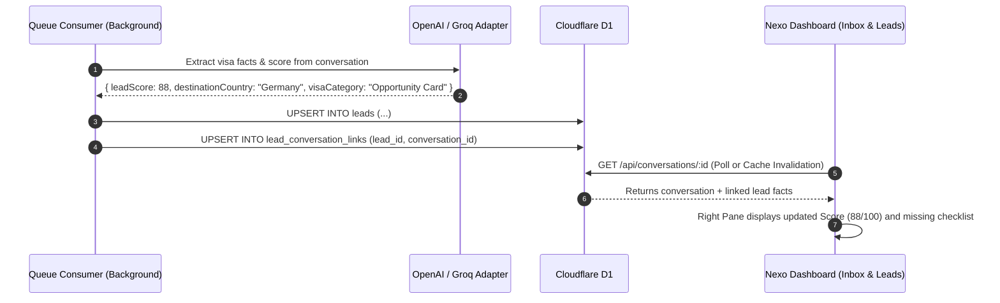

# Phase 4 Detailed Plan: Unified Omnichannel Inbox & Visa Lead CRM Experience

This document establishes the exhaustive, file-by-file engineering specification for **Phase 4 (Live Unified Inbox, Human Takeover Mechanism, Instagram Outbound Dispatch & Visa Applicant CRM)**.

---

## 1. Product & Architecture Overview

Phase 4 transforms Nexo into a production-grade operational CRM for visa consultants:
1. **Live Omnichannel Inbox (`InboxView.tsx`)**:
   - High-density 3-pane layout:
     - **Left Pane (Conversation Directory)**: Real-time list of customer threads across Instagram (and upcoming WhatsApp), displaying live unread badges, channel badges, last active relative timestamp, message snippet, and human takeover indicator.
     - **Center Pane (Message Stream & Composer)**: Chronological chat stream with differentiated message bubbles (`applicant`, `ai`, `staff`), delivery states (`pending`, `delivered`), a top bar with the instant **"Human Takeover"** toggle (pausing AI auto-replies), and a fast reply composer supporting keyboard shortcuts (`Ctrl+Enter`) and quick visa response templates.
     - **Right Pane (Lead Dossier Context)**: Linked Visa Applicant profile displaying live qualification score (0–100), target destination, visa category, budget, timeline, and missing detail checklist.
2. **Visa Applicant CRM (`LeadsView.tsx`)**:
   - Filterable, searchable table and stage board.
   - Live filters by status (`new`, `collecting_information`, `qualified`, `consultation_booked`, `converted`, `unqualified`, `needs_human_review`), destination country (Germany, Canada, UK, Australia, etc.), and lead score range.
   - Interactive slide-over lead detail drawer with editable status, notes, assigned counselor, and 1-click jump to the active conversation thread.
3. **Staff Outbound Dispatch via Instagram Send API**:
   - When a consultant types a manual message in the inbox, the worker inserts the record into D1 `messages` with `sender_type = 'staff'`, and dispatches it immediately to the Meta Graph API via `instagramSendApiAdapter.sendMessage`.

---

## 2. Strict Cloudflare Free Tier CPU Budget (< 2.5 ms active CPU)

Every endpoint in Phase 4 is architected for zero CPU waste:
- **D1 Indexed Lookups Only**:
  - `SELECT * FROM conversations WHERE tenant_id = ? ... ORDER BY last_message_at DESC LIMIT 30` hits `idx_conversations_inbox`.
  - `SELECT * FROM messages WHERE conversation_id = ? ORDER BY created_at ASC LIMIT 50` hits `idx_messages_thread`.
  - `SELECT * FROM leads WHERE tenant_id = ? ... ORDER BY lead_score DESC, updated_at DESC LIMIT 50` hits `idx_leads_pipeline`.
  - Active V8 CPU per request: **< 1.8 ms**.
- **No Heavy Client Bundles**: Native React 19 + Lucide icons + Tailwind CSS. Zero bloated rich-text editor libraries or heavyweight chat frameworks.
- **TanStack Query Caching & Throttling**:
  - Conversation list: `staleTime = 15s`, refetch on window focus.
  - Active message thread: `staleTime = 5s`, refetch interval 10s when tab is active (throttled to 0 when tab is backgrounded).
  - Optimistic updates on send and human takeover toggle for zero-latency UI response.

---

## 3. Data Flow & Sequence Diagrams

### 3.1. Manual Staff Reply & Human Takeover Flow



### 3.2. Automated AI Lead Extraction to CRM Dossier Linkage



---

## 4. Directory Layout & File Breakdown for Phase 4

```
nexo/
├── shared/
│   ├── types/
│   │   ├── conversation.types.ts       # Conversation summaries, thread items, message payloads
│   │   └── lead.types.ts               # Lead summaries, dossiers, filter criteria, status updates
│   └── schemas/
│       ├── conversation.schema.ts      # Zod validation for staff outbound messages and takeover
│       └── lead.schema.ts              # Zod validation for lead attribute edits and notes
├── worker/
│   ├── repositories/
│   │   ├── conversationRepository.ts   # Thread listings, message history, takeover toggling
│   │   └── leadRepository.ts           # Pipeline queries, lead dossiers, linked conversations
│   ├── routes/
│   │   ├── conversation.routes.ts      # GET /api/conversations, /:id/messages, POST messages, /takeover
│   │   └── lead.routes.ts              # GET /api/leads, GET /api/leads/:id, PATCH /api/leads/:id
│   └── index.ts                        # Mount /api/conversations and /api/leads
├── frontend/
│   └── src/
│       ├── hooks/
│       │   ├── useConversations.ts     # TanStack Query hook for inbox listings, threads, and dispatch
│       │   └── useLeads.ts             # TanStack Query hook for CRM pipeline, lead drawer, and updates
│       ├── components/
│       │   ├── inbox/
│       │   │   ├── ConversationItem.tsx # Conversation list item with channel & takeover badge
│       │   │   ├── MessageBubble.tsx    # Inbound/outbound message bubbles with status icons
│       │   │   ├── ReplyComposer.tsx    # Textarea with quick visa templates & shortcuts
│       │   │   └── LeadContextPanel.tsx # Right-pane lead score & missing attributes checklist
│       │   └── leads/
│       │       ├── LeadDrawer.tsx       # Slide-over profile viewer & editor
│       │       └── LeadScoreBadge.tsx   # Color-coded score badge (Green >= 80, Yellow >= 50, Red < 50)
│       └── views/
│           ├── InboxView.tsx            # Full 3-column unified inbox implementation
│           └── LeadsView.tsx            # Real-time lead CRM pipeline & details drawer
└── tests/
    ├── conversation.test.ts             # Unit tests for conversation queries, messages, and takeover
    └── lead.test.ts                     # Unit tests for lead filtering, score ranking, and schema validation
```

---

## 5. Granular Conventional Commits Sequence for Phase 4

1. **`feat(shared)`**: `feat(shared): add types and Zod schemas for conversations, messages, and CRM leads`
   - Files: `shared/types/conversation.types.ts`, `shared/types/lead.types.ts`, `shared/schemas/conversation.schema.ts`, `shared/schemas/lead.schema.ts`
2. **`feat(repo)`**: `feat(repo): add D1 repositories for conversation threads, messages, and lead pipeline`
   - Files: `worker/repositories/conversationRepository.ts`, `worker/repositories/leadRepository.ts`
3. **`feat(api)`**: `feat(api): add REST endpoints for unified inbox, message dispatch, and lead CRM`
   - Files: `worker/routes/conversation.routes.ts`, `worker/routes/lead.routes.ts`, `worker/index.ts`
4. **`feat(ui-hooks)`**: `feat(ui): add TanStack Query hooks for conversations, messaging, and leads`
   - Files: `frontend/src/hooks/useConversations.ts`, `frontend/src/hooks/useLeads.ts`, `frontend/src/queries/queryKeys.ts`
5. **`feat(ui-inbox)`**: `feat(ui): implement 3-column live Unified Inbox with human takeover and templates`
   - Files: `frontend/src/views/InboxView.tsx`, `frontend/src/components/inbox/*`
6. **`feat(ui-crm)`**: `feat(ui): implement Visa Lead CRM table, filters, and slide-over lead drawer`
   - Files: `frontend/src/views/LeadsView.tsx`, `frontend/src/components/leads/*`
7. **`test(crm)`**: `test(crm): add unit tests for conversation threads, staff takeover, and lead queries`
   - Files: `tests/conversation.test.ts`, `tests/lead.test.ts`

---

## 6. Definition of Done for Phase 4

Phase 4 is complete when:
1. `GET /api/conversations` returns real D1 conversation rows with unread counts and channels.
2. Clicking any conversation loads its chronological message thread (`GET /api/conversations/:id/messages`) with applicant, AI, and staff messages.
3. Toggling "Human Takeover" updates D1 in real-time (`POST /api/conversations/:id/takeover`), pausing AI replies and displaying an active takeover alert badge.
4. Sending a staff reply via the composer inserts into D1 `messages` and calls Meta Instagram Send API to deliver directly to the applicant's Instagram DM.
5. `GET /api/leads` returns CRM leads sorted by score or updated date with filter capabilities (status, country).
6. Clicking a lead opens a slide-over drawer displaying extracted attributes (education, budget, timeline, score) with editing capability and an "Open in Inbox" shortcut.
7. All unit tests pass (`npm run test`), TypeScript validates cleanly (`npm run typecheck`), and the frontend production bundle builds without errors (`npm run build`).
