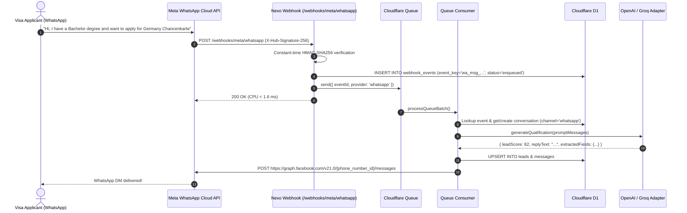
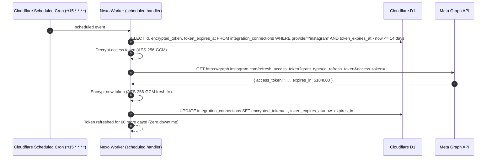

# Phase 5 Detailed Plan: WhatsApp Cloud API, Scheduled Token Lifecycle Cron & Executive Analytics

This document establishes the exhaustive, file-by-file engineering specification for **Phase 5 (Meta WhatsApp Business Cloud API, Scheduled Cron Sweeper & Token Auto-Refresh, and Real-Time Executive Analytics Dashboard)**.

---

## 1. Product & Architecture Overview

Phase 5 completes the omnichannel promise of Nexo by adding the world's most widely used messaging channel alongside Instagram, while hardening production reliability through automated token maintenance:

1. **Meta WhatsApp Business Cloud API**:
   - Full integration with Meta Cloud API (`graph.facebook.com/v21.0`).
   - Secure credential onboarding: Phone Number ID, WABA ID, System User Access Token (AES-256-GCM encrypted).
   - Inbound webhook processing (`/webhooks/meta/whatsapp`): Text messages, button clicks, and message status receipts (`delivered`, `read`).
   - Outbound dispatch via WhatsApp Send API for automated AI replies and manual counselor responses from the Unified Inbox.
2. **Automated Scheduled Cron Sweeper (`scheduled` handler)**:
   - Instagram 60-day token auto-refresh before expiration (triggers when within 14 days of expiry).
   - Dead-letter & stuck webhook event recovery.
3. **Real-Time Executive Analytics Dashboard (`OverviewView.tsx`)**:
   - Live D1 aggregated KPIs: Active DMs, Qualified Leads, Channel Breakdown (Instagram vs WhatsApp), Destination Country distribution, and AI vs Human Takeover ratios.

---

## 2. Strict Cloudflare Free Tier CPU Budget (< 2.5 ms active CPU)

- **WhatsApp Webhook Ingestion**:
  - Size limit (< 128 KiB) + Constant-time HMAC-SHA256 signature check (`X-Hub-Signature-256`) + D1 insert + Queue enqueue. Active CPU: **~1.6 ms**.
- **Scheduled Cron Sweeper**:
  - Runs every 15 minutes. Queries D1 for expiring tokens (`SELECT ... WHERE token_expires_at - ? < 1209600000`). If none expiring, exits in **< 0.5 ms active CPU**.
- **Analytics Aggregation**:
  - Single multi-statement D1 query or indexed COUNT/SUM queries:
    - `SELECT COUNT(*) FROM conversations WHERE tenant_id = ?`
    - `SELECT lead_status, COUNT(*) FROM leads WHERE tenant_id = ? GROUP BY lead_status`
    - `SELECT destination_country, COUNT(*) FROM leads WHERE tenant_id = ? GROUP BY destination_country ORDER BY COUNT(*) DESC LIMIT 5`
  - Total active CPU: **< 1.9 ms**.

---

## 3. Data Flow & Sequence Diagrams

### 3.1. WhatsApp Inbound Webhook to AI Qualification & Send Flow



### 3.2. Automated Instagram 60-Day Token Refresh Cron



---

## 4. Directory Layout & File Breakdown for Phase 5

```
nexo/
├── shared/
│   ├── types/
│   │   ├── whatsapp.types.ts           # WhatsApp Cloud API credentials, payloads, and message structures
│   │   └── analytics.types.ts          # Overview KPIs, channel breakdown, and destination metrics
│   └── schemas/
│       └── whatsapp.schema.ts          # Zod schema for WhatsApp connection form and webhook verification
├── worker/
│   ├── adapters/
│   │   └── meta/
│   │       ├── whatsappSendApi.ts      # Cloud API outbound dispatcher (text & interactive buttons)
│   │       └── whatsappWebhook.ts      # Webhook normalizer for messages and status receipts
│   ├── services/
│   │   ├── tokenRefreshService.ts      # Instagram 60-day token auto-refresher
│   │   └── analyticsService.ts         # Fast D1 KPI aggregation queries (< 1.9 ms CPU)
│   ├── routes/
│   │   ├── whatsapp.routes.ts          # POST /api/integrations/whatsapp/connect & /disconnect
│   │   ├── analytics.routes.ts         # GET /api/analytics/overview
│   │   └── webhook.routes.ts           # Mounted /webhooks/meta/whatsapp (GET & POST)
│   ├── queue/
│   │   └── consumer.ts                 # Expanded to dispatch outbound WhatsApp replies
│   └── index.ts                        # Wire scheduled cron handler & mount analytics routes
├── frontend/
│   └── src/
│       ├── hooks/
│       │   ├── useWhatsApp.ts          # Hook for connecting WhatsApp Cloud API
│       │   └── useAnalytics.ts         # Hook for overview KPIs and channel stats
│       ├── components/
│       │   └── integrations/
│       │       └── WhatsAppConnectModal.tsx # Modal for Phone Number ID, WABA ID & System Token
│       └── views/
│           ├── IntegrationsView.tsx    # Live WhatsApp connection status & modal trigger
│           └── OverviewView.tsx        # Live KPI metrics, destination breakdown, conversion funnel
└── tests/
    ├── whatsappWebhook.test.ts         # Tests for WhatsApp webhook normalization and status filtering
    ├── whatsappSendApi.test.ts         # Tests for payload formatting and recipient formatting
    └── tokenRefresh.test.ts            # Tests for token expiration evaluation and refresh requests
```

---

## 5. Granular Conventional Commits Sequence for Phase 5

1. **`feat(shared)`**: `feat(shared): add types and Zod schemas for WhatsApp Cloud API and analytics`
   - Files: `shared/types/whatsapp.types.ts`, `shared/types/analytics.types.ts`, `shared/schemas/whatsapp.schema.ts`
2. **`feat(meta-wa)`**: `feat(meta): add WhatsApp Cloud API Send adapter and webhook normalizer`
   - Files: `worker/adapters/meta/whatsappSendApi.ts`, `worker/adapters/meta/whatsappWebhook.ts`
3. **`feat(api-wa)`**: `feat(api): add WhatsApp connection endpoints and webhook routes`
   - Files: `worker/routes/whatsapp.routes.ts`, `worker/routes/webhook.routes.ts`, `worker/queue/consumer.ts`
4. **`feat(cron)`**: `feat(cron): implement scheduled Instagram 60-day token auto-refresh and outbox sweeper`
   - Files: `worker/services/tokenRefreshService.ts`, `worker/index.ts`
5. **`feat(analytics)`**: `feat(analytics): add D1 analytics aggregation service and API endpoint`
   - Files: `worker/services/analyticsService.ts`, `worker/routes/analytics.routes.ts`, `worker/index.ts`
6. **`feat(ui-wa)`**: `feat(ui): add WhatsApp connection modal and status badge in IntegrationsView`
   - Files: `frontend/src/hooks/useWhatsApp.ts`, `frontend/src/components/integrations/WhatsAppConnectModal.tsx`, `frontend/src/views/IntegrationsView.tsx`
7. **`feat(ui-analytics)`**: `feat(ui): wire OverviewView with real-time analytics, KPI cards, and charts`
   - Files: `frontend/src/hooks/useAnalytics.ts`, `frontend/src/views/OverviewView.tsx`
8. **`test(wa)`**: `test(wa): add unit tests for WhatsApp webhooks, Send API, and token refresh cron`
   - Files: `tests/whatsappWebhook.test.ts`, `tests/whatsappSendApi.test.ts`, `tests/tokenRefresh.test.ts`

---

## 6. Definition of Done for Phase 5

Phase 5 is complete when:
1. WhatsApp Business Cloud API can be connected with Phone Number ID, WABA ID, and System User Token (encrypted with AES-256-GCM in D1).
2. Inbound WhatsApp messages arriving at `/webhooks/meta/whatsapp` are signature-verified, normalized, and enqueued to Cloudflare Queue in < 1.6 ms CPU.
3. Queue consumer processes inbound WhatsApp messages, extracts visa facts, and dispatches AI replies via WhatsApp Send API.
4. Staff can reply to WhatsApp applicants from the Unified Inbox (`InboxView.tsx`).
5. Scheduled cron handler evaluates Instagram connection token expiration and successfully refreshes tokens within the 14-day window.
6. `GET /api/analytics/overview` delivers real-time aggregated metrics from D1 and `OverviewView.tsx` renders live KPI cards, country distribution, and channel breakdowns.
7. All tests pass (`npm run test`), TypeScript compiles with zero errors (`npm run typecheck`), and the frontend builds cleanly (`npm run build`).
